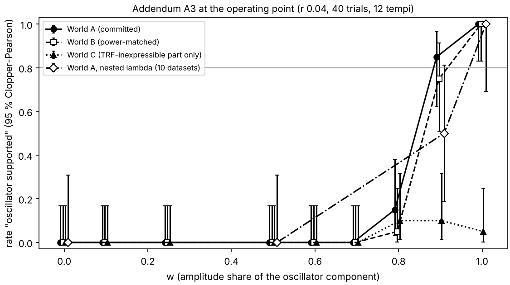

# Identifiability map: results (EXPLORATORY; methods contribution)

Plan and grid: `docs/IDENTIFIABILITY_PLAN.md` (committed before any cell ran; addendum for the four
refinement cells). Code: `weineck/identifiability_precompute.py`, `weineck/identifiability_sim.py`,
`weineck/run_identifiability_queue.sh`, `weineck/identifiability_merge.py`. Aggregate output:
`weineck/results/identifiability.json`; figures `docs/figures/identifiability_heatmap.png` and
`docs/figures/identifiability_tempi.png`. Pre-registration frozen at `935c80a` untouched; no
committed model or rule was tuned. Run 2026-11-10 after the stage-2 merge.

## Headline

**At Weineck's operating point (held-out r 0.04, 40 trials per tempo, 12 training tempi), the
committed Theory 3 rule detects an oscillator component with 80 % power only when that component
supplies about 89 % of the stimulus-locked amplitude (about 99 % of its variance). The
false-positive rate at that point, and in every one of the 16 evoked-only cells, is 0.00.**

Operating-point curve (20 simulated datasets of 20 participants per w; rate = fraction of datasets
in which the rule said "oscillator supported"):

| w (amplitude share) | 0 | 0.1 | 0.25 | 0.5 | 0.6 | 0.7 | 0.8 | 0.9 | 1.0 |
|---|---|---|---|---|---|---|---|---|---|
| rate | 0.00 | 0.00 | 0.00 | 0.00 | 0.00 | 0.00 | 0.15 | 0.85 | 1.00 |
| median delta r (aug minus best TRF) | -0.0067 | -0.0056 | -0.0038 | -0.0000 | +0.0016 | +0.0032 | +0.0047 | +0.0058 | +0.0069 |
| realised held-out r of d_short | 0.040 | 0.038 | 0.036 | 0.032 | 0.032 | 0.031 | 0.030 | 0.030 | 0.029 |

W (80 % power) by linear interpolation on the refined grid: 0.893 amplitude share (variance share
0.986); on the coarse plan grid alone: 0.90. The real data gave median delta r = -0.010 with 3/34
participants positive (`docs/THEORY3_RESULTS.md`), which sits at the evoked-only end of this curve.

## The map (12 training tempi; rate per cell, 20 datasets)

Entries are w = 0 / 0.1 / 0.25 / 0.5 / 1 (w = 0 is the false-positive rate).

| held-out r | 20 trials | 40 trials | 80 trials | 160 trials |
|---|---|---|---|---|
| 0.02 | 0 / 0 / 0 / 0 / 0.60 | 0 / 0 / 0 / 0 / 0.70 | 0 / 0 / 0 / 0 / 0.85 | 0 / 0 / 0 / 0 / 0.95 |
| 0.04 (Weineck) | 0 / 0 / 0 / 0 / 0.65 | 0 / 0 / 0 / 0 / 1.00 | 0 / 0 / 0 / 0 / 1.00 | 0 / 0 / 0 / 0 / 1.00 |
| 0.08 | 0 / 0 / 0 / 0 / 0.95 | 0 / 0 / 0 / 0 / 1.00 | 0 / 0 / 0 / 0 / 1.00 | 0 / 0 / 0 / 0 / 1.00 |
| 0.16 | 0 / 0 / 0 / 0 / 1.00 | 0 / 0 / 0 / 0 / 1.00 | 0 / 0 / 0 / 0 / 1.00 | 0 / 0 / 0 / 0 / 1.00 |

Median delta r of the augmented model against the best TRF, by world:

| held-out r | w = 0 (20/40/80/160 trials) | w = 0.5 | w = 1 |
|---|---|---|---|
| 0.02 | -0.006 / -0.005 / -0.004 / -0.004 | -0.0005 / -0.0006 / -0.0004 / -0.0002 | +0.004 / +0.004 / +0.004 / +0.004 |
| 0.04 | -0.008 / -0.007 / -0.006 / -0.006 | -0.0002 / -0.0000 / +0.0002 / +0.0001 | +0.007 / +0.007 / +0.006 / +0.006 |
| 0.08 | -0.012 / -0.011 / -0.011 / -0.011 | +0.0007 / +0.0005 / +0.0002 / +0.0000 | +0.012 / +0.011 / +0.010 / +0.010 |
| 0.16 | -0.022 / -0.022 / -0.021 / -0.021 | +0.0001 / -0.0002 / -0.0004 / -0.0005 | +0.021 / +0.020 / +0.019 / +0.019 |

## Reading

1. **The blind spot is a property of the rule, not of the SNR.** The 80 % point is w = 0.90 (coarse
   grid) in 13 of the 16 (r, trials) cells, above 0.9 in two low-SNR cells and unreached at r = 0.02
   with 20 or 40 trials. Raising the SNR by a factor of eight or the trial count by a factor of eight
   does not move it. The reason is visible in the delta r table: at w = 0 the augmented model (840
   oscillator-bank regressors added to the 109-column TRF, lambda fixed at the modal value 10) pays
   a penalty that scales with the SNR (-0.006 at r 0.02, -0.022 at r 0.16), and the gain from a true
   oscillator component scales the same way, so the two cancel at w close to 0.5 at every SNR and
   the one-sided test on "aug beats the best TRF" cannot fire until the oscillator share is near 0.9.
   **Correction (2026-11-11, addendum A3):** the last clause is wrong. Parsed per dataset, the first
   criterion (aug beats the best TRF, p < 0.01) already passes in 20 of 20 datasets at w = 0.6, 0.7
   and 0.8 at the operating point. Between w = 0.6 and 0.9 the rule is held back by its second
   criterion (Hopf-augmented model beats the linear-bank-augmented model, p < 0.05). The cancellation
   at w close to 0.5 is correct and sets where criterion 1 starts to pass; see the A3 section.
2. **The rule is conservative.** No evoked-only dataset triggered it anywhere (0 of 320 datasets).
3. **What the Theory 3 null means.** `docs/THEORY3_RESULTS.md` reports "not supported" on the real
   data. By this map, that null excludes only worlds in which an oscillator supplies at least about
   nine tenths of the stimulus-locked amplitude at Weineck's SNR; a mixed world with an oscillator at
   half the amplitude (half the variance) would have produced the same null with near certainty. The
   real delta r (-0.010, 3/34 positive) is in fact more negative than the simulated evoked-only world
   (-0.007), i.e. the real data look like the w = 0 end of the curve, but the test cannot separate
   w = 0 from w = 0.5.
4. **Trial count helps only the oscillator-only world at the lowest SNR** (0.60 to 0.95 from 20 to
   160 trials at r = 0.02); elsewhere the oscillator-only world is detected in every dataset.

## Training-tempi axis (r 0.04, 40 trials per tempo)

Entries: rate (median delta r). 20 datasets per cell; leave-one-tempo-out over n + 1 tempi.

| training tempi | w = 0 | 0.1 | 0.25 | 0.5 | 1.0 |
|---|---|---|---|---|---|
| 4 | 0.00 (-0.0097) | 0.00 (-0.0078) | 0.00 (-0.0056) | 0.00 (-0.0006) | 0.30 (+0.0083) |
| 8 | 0.00 (-0.0076) | 0.00 (-0.0064) | 0.00 (-0.0041) | 0.00 (+0.0004) | 1.00 (+0.0077) |
| 12 (Weineck) | 0.00 (-0.0067) | 0.00 (-0.0056) | 0.00 (-0.0038) | 0.00 (-0.0000) | 1.00 (+0.0069) |

Fewer training tempi lower the power for the oscillator-only world (0.30 at 4 tempi; the 20-participant
Wilcoxon rarely clears p < 0.01 when the per-participant delta r is noisier) and deepen the augmented
model's penalty at w = 0 (-0.010 at 4 tempi vs -0.007 at 12), but they do not move the crossing: the
mixture at w = 0.5 sits at delta r = 0 on every row. The blind spot is the same with 4, 8 or 12 tempi.

## Overlap of the two generating predictions (added 2026-11-10, after the grid)

Pearson r between the evoked-kernel prediction (TRF) and the oscillator-kernel prediction (Hopf bank)
on the real stimulus pool, one kernel pair per participant (34 pairs, 388 stimuli;
`weineck/results/identifiability/prediction_overlap.json`): pooled over the pool, median 0.53
(IQR 0.48 to 0.58, range 0.34 to 0.65); median within a stimulus 0.56. The two worlds share about a
quarter of their variance, which is part of why a mixture is hard to tell from the evoked-only world.

## Addendum A3 (exploratory; plan and decision rule committed at `cf0a65e` before any A3 cell ran)

World A is the grid above, unchanged. World B rescales the signal at every w to the variance of World
A's w = 0 signal (constant total SNR). World C keeps only the part of the oscillator prediction that the
short TRF design cannot express (OLS residual per participant kernel), power-matched as in B. The
nested-lambda check reruns World A with lambda chosen per model and outer fold by inner
leave-one-tempo-out over {0.1, 1, 10, 100, 1000}, as the real pipeline does (oscillator configuration
fixed at the committed one). Every A3 cell reuses the seed of the World A cell with the same w, so the
comparisons are paired on the same trials and noise. Code: `weineck/identifiability_sim.py` (`--world`,
`--nested`), `weineck/run_identifiability_a3.sh`, `weineck/identifiability_merge_a3.py`; numbers in
`weineck/results/identifiability.json`, key `A3`. Checks: World A reproduces the committed cells to
1e-10; World B and World C at w = 0 are bit-identical to World A at w = 0.

### Decision (rule applied verbatim)

**W80 > 0.8 in World B, World C and the nested-lambda check: the 0.89 headline stands as a property of
the rule.**

| world (operating point) | W80 | bracket | false-positive rate [95 % CI] | datasets per w |
|---|---|---|---|---|
| A (committed) | 0.89 | 0.8-0.9 | 0.00 [0.00, 0.17] | 20 |
| B (power-matched) | 0.92 | 0.9-1.0 | 0.00 [0.00, 0.17] | 20 |
| C (TRF-inexpressible part only) | not reached (max 0.10) | - | 0.00 [0.00, 0.17] | 20 |
| A, nested lambda | 0.96 | 0.9-1.0 | 0.00 [0.00, 0.31] | 10 |
| A refined, r 0.08, 40 trials | 0.88 | 0.8-0.9 | 0.00 [0.00, 0.17] | 20 |
| A refined, r 0.04, 160 trials | 0.89 | 0.8-0.9 | 0.00 [0.00, 0.17] | 20 |

Detection rate by w at the operating point, 95 % Clopper-Pearson intervals in brackets:

| w | A | B | C | A, nested lambda |
|---|---|---|---|---|
| 0 | 0.00 [0.00, 0.17] | 0.00 [0.00, 0.17] | 0.00 [0.00, 0.17] | 0.00 [0.00, 0.31] |
| 0.1 | 0.00 [0.00, 0.17] | 0.00 [0.00, 0.17] | 0.00 [0.00, 0.17] | |
| 0.25 | 0.00 [0.00, 0.17] | 0.00 [0.00, 0.17] | 0.00 [0.00, 0.17] | |
| 0.5 | 0.00 [0.00, 0.17] | 0.00 [0.00, 0.17] | 0.00 [0.00, 0.17] | 0.00 [0.00, 0.31] |
| 0.6 | 0.00 [0.00, 0.17] | 0.00 [0.00, 0.17] | 0.00 [0.00, 0.17] | |
| 0.7 | 0.00 [0.00, 0.17] | 0.00 [0.00, 0.17] | 0.00 [0.00, 0.17] | |
| 0.8 | 0.15 [0.03, 0.38] | 0.05 [0.00, 0.25] | 0.10 [0.01, 0.32] | |
| 0.9 | 0.85 [0.62, 0.97] | 0.75 [0.51, 0.91] | 0.10 [0.01, 0.32] | 0.50 [0.19, 0.81] |
| 1.0 | 1.00 [0.83, 1.00] | 1.00 [0.83, 1.00] | 0.05 [0.00, 0.25] | 1.00 [0.69, 1.00] |

Refined World A cells (rate at w = 0.6 / 0.7 / 0.8 / 0.9): r 0.08 with 40 trials 0.00 / 0.00 / 0.00 /
1.00; r 0.04 with 160 trials 0.00 / 0.00 / 0.10 / 0.90. The 0.90 entries of the original map at these
cells were interpolation; the real crossings are 0.88 and 0.89.

**Nested lambda vs fixed lambda, paired on the same 10 datasets:** w = 0: 0.00 vs 0.00 (median delta r
-0.0045 vs -0.0067); w = 0.5: 0.00 vs 0.00; w = 0.9: 0.50 vs 0.90 (+0.0050 vs +0.0060); w = 1: 1.00 vs
1.00. Inner selection mostly chose lambda 1 for the Hopf-augmented model at w = 0 (fixed: 10), which
shrinks its evoked-only penalty, and moved the linear-bank-augmented model from 0.1-1 up to 10 when an
oscillator was present (fixed: 1), which makes the Hopf-vs-linear criterion harder to pass. Net effect:
less sensitive, not more.

**TRF-expressible fraction of the oscillator prediction** (R^2 of P_o on the TRF design, pooled over the
388-stimulus pool, 34 kernels): short TRF (0-400 ms) median 0.62 (IQR 0.57-0.71, range 0.29-0.85); long
TRF (0-1000 ms) median 0.82 (IQR 0.78-0.88, range 0.47-0.93). The evoked and oscillator generating
predictions correlate at a median r of 0.53.

### Criterion 1 alone: exploratory decomposition, outside the committed rule

The rule says "oscillator supported" when (1) the Hopf-augmented model beats the best TRF (median delta r
> 0, one-sided Wilcoxon p < 0.01) and (2) it beats the linear-bank-augmented model (p < 0.05). The table
gives the fraction of datasets passing criterion 1 alone at the operating point (r 0.04, 40 trials, 12
tempi), parsed from the per-dataset log lines of the existing cells (no new runs), with 95 %
Clopper-Pearson intervals. W80 is linear interpolation between the bracketing w values. Source:
`weineck/results/identifiability.json`, key `A3.diagnostic_criterion1_only`.

| w | A | B | C | A, nested lambda |
|---|---|---|---|---|
| 0 | 0.00 [0.00, 0.17] | 0.00 [0.00, 0.17] | 0.00 [0.00, 0.17] | 0.00 [0.00, 0.31] |
| 0.1 | 0.00 [0.00, 0.17] | 0.00 [0.00, 0.17] | 0.00 [0.00, 0.17] |  |
| 0.25 | 0.00 [0.00, 0.17] | 0.00 [0.00, 0.17] | 0.00 [0.00, 0.17] |  |
| 0.5 | 0.00 [0.00, 0.17] | 0.00 [0.00, 0.17] | 0.90 [0.68, 0.99] | 0.00 [0.00, 0.31] |
| 0.6 | 1.00 [0.83, 1.00] | 0.95 [0.75, 1.00] | 1.00 [0.83, 1.00] |  |
| 0.7 | 1.00 [0.83, 1.00] | 1.00 [0.83, 1.00] | 1.00 [0.83, 1.00] |  |
| 0.8 | 1.00 [0.83, 1.00] | 1.00 [0.83, 1.00] | 1.00 [0.83, 1.00] |  |
| 0.9 | 1.00 [0.83, 1.00] | 1.00 [0.83, 1.00] | 1.00 [0.83, 1.00] | 1.00 [0.69, 1.00] |
| 1 | 1.00 [0.83, 1.00] | 1.00 [0.83, 1.00] | 1.00 [0.83, 1.00] | 1.00 [0.69, 1.00] |
| **W80, criterion 1 alone** | **0.58** (bracket 0.5-0.6) | **0.58** (bracket 0.5-0.6) | **0.47** (bracket 0.25-0.5) | **0.82** (bracket 0.5-0.9) |

Reading, labelled as inference:
* Criterion 1 crosses 80 % at about w = 0.58 in Worlds A and B and at about 0.47 in World C. The test
  against the TRF does register oscillator structure once it supplies about half the stimulus-locked
  amplitude; between w = 0.6 and 0.9 the full rule is held back by criterion 2 (Hopf beating the linear
  oscillator bank).
* The steps are sharp (0.00 at w = 0.5, 0.95-1.00 at w = 0.6 in A and B), so each W80 is known only to
  within its bracket. The nested-lambda bracket (0.5-0.9) is wide because only w = 0, 0.5, 0.9 and 1 were
  run.
* World C gives the lowest number of the three, not the highest: removing the TRF-expressible part
  leaves a signal the best TRF cannot fit at all, so criterion 1 passes sooner.

### Criterion-2 diagnostic (exploratory, outside the committed rule)

World A and World C rerun at the operating point, w = 1, 10 datasets each, on the seeds of the committed
cells (dataset 1 reproduces the committed values: +0.0070 and +0.0112), storing per dataset the median
Hopf-augmented minus linear-bank-augmented delta r and its one-sided Wilcoxon p, at the committed lambda
(10 for aug, 1 for aug_lin) and with aug refitted at lambda 1. Expressibility is computed exactly from the
pooled statistics: the part of the oscillator generator that the linear-bank-augmented design cannot
express is the only part aug can fit and aug_lin cannot. Code `weineck/identifiability_crit2_diag.py`;
numbers in `weineck/results/identifiability/criterion2_diagnostic.json`.

| | World A, w = 1 | World C, w = 1 |
|---|---|---|
| full rule, rate | 1.00 (10/10) | 0.00 (0/10) |
| median aug minus best TRF | +0.0068 | +0.0103 |
| median aug minus aug_lin, committed lambdas | +0.0009 | +0.0001 |
| criterion 2 passes (p < 0.05), committed lambdas | 10/10 | 0/10 |
| median aug minus aug_lin, aug refitted at lambda 1 | -0.0006 | +0.0004 |
| criterion 2 passes, aug at lambda 1 | 0/10 | 0/10 |
| generator variance the linear-bank design cannot express (median over 34 kernels) | 5.5 % | 17.6 % |

The Hopf-specific variance is identical in absolute size in the two worlds (largest relative difference
5e-11), because World C only removes a part of the generator that lies inside the TRF design, which both
augmented designs contain.

**Why World C fails criterion 2:** the Hopf-specific structure, though a larger share of the World C
signal, gives the Hopf model almost no held-out-tempo advantage over the linear bank (median +0.0001), and
criterion 2 passes in World A only through the committed lambda asymmetry (10 for aug, 1 for aug_lin):
with aug refitted at lambda 1 its World A advantage turns to -0.0006 and criterion 2 passes in 0 of 10.
I don't know why the asymmetry helps in World A and not in World C; the runs do not isolate it.
Consequence for tier (a) of the headline: at w near 1 the full rule's passes in World A rest on the
committed lambda pair, not on a lambda-independent held-out advantage of Hopf-specific structure. Under
the real pipeline's nested lambda the rule still detected World A at w = 1 in 10 of 10 datasets.

### Placement of the real data (exploratory)

On the 34 real participants criterion 1 itself failed: delta r (aug minus best evoked baseline) median
-0.010, positive in 3 of 34, one-sided Wilcoxon p = 1.00 (`docs/THEORY3_RESULTS.md`;
`weineck/results/oscillator_heldout_merged.json`, keys `delta_r_aug`, `p_aug`). The simulated evoked-only
world gives -0.007 at this operating point, so the real data sit at the evoked-only end of the curve.

By the criterion-1 table, a world in which TRF-inexpressible oscillatory structure supplied about 47 % or
more of the stimulus-locked amplitude (World C) would have passed criterion 1 in at least 80 % of
simulated datasets; the real data did not pass it. This is the exploratory exclusion, with four
qualifications stated, not corrected:
1. World C's 0.47 is the smallest of the criterion-1 W80 values. Using World A's or B's 0.58 instead would
   exclude less.
2. The real pipeline selected lambda (and the oscillator configuration) in a nested loop. In World A,
   nested lambda moved the criterion-1 crossing from 0.58 to somewhere in 0.5-0.9; World C was not run with
   nested lambda, so the exclusion under the real pipeline's procedure is not pinned below 0.9.
3. The real group test had 34 participants; each simulated dataset had 20. More participants give more
   power, so on this count the simulated W80 is conservative.
4. The simulation fixes the oscillator configuration and uses Gaussian noise with a smooth spectrum; see
   the limitations below.

## Addendum A4 (exploratory, outside the committed rule; plan committed at `a0013f4` before any A4 cell ran)

All A4 cells are at the operating point (held-out r 0.04, 40 trials per tempo, 12 training tempi) on the A3 seeds,
so they reuse the A3 datasets (checked: the committed-pair columns below reproduce the A3 rule rates exactly).
Numbers in `weineck/results/identifiability.json`, key `A4` (also `weineck/results/identifiability/a4_summary.json`);
code `weineck/identifiability_sim.py` (`--nested`, `--lampair`), `weineck/run_identifiability_a4.sh`,
`weineck/identifiability_merge_a4.py`. Clopper-Pearson 95 % intervals throughout.

### A4.1 Criterion 1 under the real pipeline's nested lambda

Fraction of datasets in which the Hopf-augmented model beats the best TRF (median delta r > 0, one-sided Wilcoxon
p < 0.01), 10 datasets x 20 participants per cell. World A at w = 0, 0.5, 0.9 and 1 are the A3 nested cells
(criterion 1 parsed from their logs); all other cells are new.

| w | World A, nested lambda | World C, nested lambda |
|---|---|---|
| 0 | 0/10 = 0.00 [0.00, 0.31] | not run |
| 0.5 | 0/10 = 0.00 [0.00, 0.31] | not run |
| 0.6 | 9/10 = 0.90 [0.55, 1.00] | 10/10 = 1.00 [0.69, 1.00] |
| 0.7 | 10/10 = 1.00 [0.69, 1.00] | 10/10 = 1.00 [0.69, 1.00] |
| 0.8 | 10/10 = 1.00 [0.69, 1.00] | 10/10 = 1.00 [0.69, 1.00] |
| 0.9 | 10/10 = 1.00 [0.69, 1.00] | 10/10 = 1.00 [0.69, 1.00] |
| 1 | 10/10 = 1.00 [0.69, 1.00] | 10/10 = 1.00 [0.69, 1.00] |

W80 for criterion 1 under nested lambda: **World A 0.59 (bracket 0.5-0.6)**; **World C at or below 0.6** (already
10/10 at the lowest w run; w < 0.6 was not run under nested lambda for World C). Under fixed lambda the values were A
0.58, B 0.58, C 0.47. Nested lambda therefore leaves the criterion-1 crossing where it was; the largest value among the
worlds, and the conservative bound for tier (b), is about 0.6.

### A4.2 Sensitivity of the committed rule to its lambda pair (criterion 2)

Fraction of datasets in which the Hopf-augmented model beats the linear-bank-augmented model (one-sided Wilcoxon
p < 0.05). Committed pair, both at lambda 1 and both at lambda 10: fixed-lambda reruns, 20 datasets. Both nested: each
model's lambda chosen by its own inner leave-one-tempo-out, 10 datasets (World A at w = 0.9 and 1: criterion 2
inferred from the stored rule outcome, because criterion 1 passed in every dataset there; all other nested cells store
the p-value). This is the sensitivity of the committed rule to its lambda pair; the committed rule and its results
are unchanged.

| world, w | committed pair (Hopf 10, linear 1) | both lambda 1 | both lambda 10 | both nested (each model's own inner loop) |
|---|---|---|---|---|
| A, 0.8 | 3/20 = 0.15 [0.03, 0.38] | 0/20 = 0.00 [0.00, 0.17] | 2/20 = 0.10 [0.01, 0.32] | 1/10 = 0.10 [0.00, 0.45] |
| A, 0.9 | 17/20 = 0.85 [0.62, 0.97] | 0/20 = 0.00 [0.00, 0.17] | 11/20 = 0.55 [0.32, 0.77] | 5/10 = 0.50 [0.19, 0.81] |
| A, 1 | 20/20 = 1.00 [0.83, 1.00] | 0/20 = 0.00 [0.00, 0.17] | 18/20 = 0.90 [0.68, 0.99] | 10/10 = 1.00 [0.69, 1.00] |
| C, 0.8 | 2/20 = 0.10 [0.01, 0.32] | 1/20 = 0.05 [0.00, 0.25] | 20/20 = 1.00 [0.83, 1.00] | 0/10 = 0.00 [0.00, 0.31] |
| C, 0.9 | 2/20 = 0.10 [0.01, 0.32] | 3/20 = 0.15 [0.03, 0.38] | 20/20 = 1.00 [0.83, 1.00] | 0/10 = 0.00 [0.00, 0.31] |
| C, 1 | 1/20 = 0.05 [0.00, 0.25] | 1/20 = 0.05 [0.00, 0.25] | 20/20 = 1.00 [0.83, 1.00] | 0/10 = 0.00 [0.00, 0.31] |

Median over datasets of the median (Hopf + TRF minus linear bank + TRF) held-out r:

| world, w | committed pair | both lambda 1 | both lambda 10 |
|---|---|---|---|
| A, 0.8 | +0.0002 | -0.0012 | +0.0002 |
| A, 0.9 | +0.0005 | -0.0009 | +0.0005 |
| A, 1 | +0.0008 | -0.0006 | +0.0007 |
| C, 0.8 | +0.0002 | +0.0005 | +0.0023 |
| C, 0.9 | +0.0003 | +0.0003 | +0.0021 |
| C, 1 | -0.0000 | +0.0004 | +0.0020 |

Reading (inference):
* Criterion 2 has no lambda-stable answer. In World A it never passes at matched lambda 1 (0/20 at every w), passes
  mostly at matched lambda 10 (18/20 at w = 1) and under nested lambda (10/10 at w = 1). In World C it fails under the
  committed pair and under nested lambda (0/10 at every w) but passes in every dataset at matched lambda 10 from w = 0.8
  (20/20; median advantage about +0.002, ten times the committed-pair value).
* In World C the linear-bank model is the one that prefers a small lambda: holding it at 10 handicaps it, and the
  Hopf model's apparent advantage at matched lambda 10 comes from that handicap. With each model at its own inner-loop
  lambda (the real pipeline's procedure), the TRF-inexpressible Hopf-specific structure gives no detectable advantage
  over the linear bank in World C (0/10 at every w), while in World A it does at w = 1 (10/10) and in half the
  datasets at w = 0.9.
* So the full rule's W80 depends on the lambda procedure as follows, at the operating point: committed pair 0.89
  (World A), not reached (World C); nested lambda 0.96 (World A, bracket 0.9-1.0), not reached (World C); matched
  lambda 1: not reached in World A (criterion 2 0/20); matched lambda 10 would detect World C at w >= 0.8 if
  criterion 1 also passes there (it does, 20/20 at the committed lambda; not recomputed at matched lambda).

## Limitations (stated, not corrected)

* The main grid fixes lambda per model at the modal value chosen on the real data (10 for the
  augmented Hopf model, 1 for the others). Addendum A3 checked this at the operating point: nested
  selection shrinks the evoked-only penalty but makes the Hopf-vs-linear criterion harder, and W80
  moves from 0.89 to the 0.9-1.0 bracket (10 datasets per w).
* 20 datasets per cell (the brief asked for 50): a rate of 0.00 over 20 datasets has a one-sided
  97.5 % upper bound of about 0.17; the refinement cells at w = 0.8 and 0.9 (0.15 and 0.85) carry
  binomial standard errors of about 0.08.
* The oscillator world is the committed Hopf bank with the participant's fitted oscillator kernel; a
  different oscillator model, or a phase-resetting rather than driven one, is a different world.
* Noise is Gaussian with the pooled residual spectrum shape and no spectral lines; real EEG has
  non-stationarity and artefacts that this does not model. The realised held-out r of the evoked
  model was calibrated to within 0.0005 of each target at w = 0 (`calibration.json`).
* The target is the fronto-central channel mean and the kernels are ridge fits, as in the plan.

## Consequence for the paper

The held-out-tempo encoding comparison, as committed, is a valid but weak instrument for the
oscillator question at single-listen SNR: it is conservative (no false positives) and sensitive only
to near-pure oscillator worlds. This is the methods contribution: a calibrated statement of what the
"oscillator not supported" result can and cannot exclude, with the map to show where a future design
(higher SNR per trial, or a rule that penalises the augmented model less) would need to sit.
