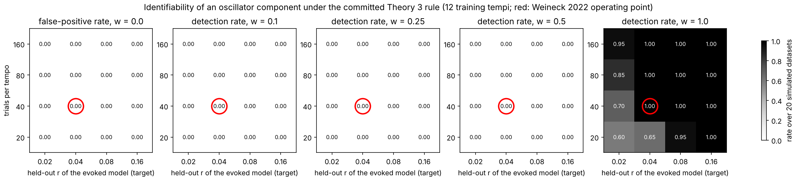
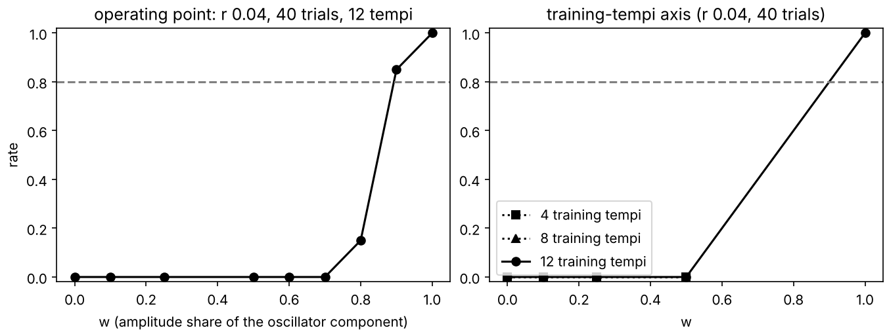

# Identifiability map: results (EXPLORATORY; methods contribution)

Plan and grid: `docs/IDENTIFIABILITY_PLAN.md` (committed before any cell ran; addendum for the four
refinement cells). Code: `weineck/identifiability_precompute.py`, `weineck/identifiability_sim.py`,
`weineck/run_identifiability_queue.sh`, `weineck/identifiability_merge.py`. Aggregate output:
`weineck/results/identifiability.json`; figures `docs/figures/identifiability_heatmap.png` and
`docs/figures/identifiability_tempi.png`. Pre-registration frozen at `935c80a` untouched; no
committed model or rule was tuned. Run 2026-11-10 after the stage-2 merge.

## Headline

**At Weineck's operating point (held-out r 0.04, 40 trials per tempo, 12 training tempi), the
committed Theory 3 rule detects an oscillator component with 80 % power only when that component
supplies about 89 % of the stimulus-locked amplitude (about 99 % of its variance). The
false-positive rate at that point, and in every one of the 16 evoked-only cells, is 0.00.**

Operating-point curve (20 simulated datasets of 20 participants per w; rate = fraction of datasets
in which the rule said "oscillator supported"):

| w (amplitude share) | 0 | 0.1 | 0.25 | 0.5 | 0.6 | 0.7 | 0.8 | 0.9 | 1.0 |
|---|---|---|---|---|---|---|---|---|---|
| rate | 0.00 | 0.00 | 0.00 | 0.00 | 0.00 | 0.00 | 0.15 | 0.85 | 1.00 |
| median delta r (aug minus best TRF) | -0.0067 | -0.0056 | -0.0038 | -0.0000 | +0.0016 | +0.0032 | +0.0047 | +0.0058 | +0.0069 |
| realised held-out r of d_short | 0.040 | 0.038 | 0.036 | 0.032 | 0.032 | 0.031 | 0.030 | 0.030 | 0.029 |

W (80 % power) by linear interpolation on the refined grid: 0.893 amplitude share (variance share
0.986); on the coarse plan grid alone: 0.90. The real data gave median delta r = -0.010 with 3/34
participants positive (`docs/THEORY3_RESULTS.md`), which sits at the evoked-only end of this curve.

## The map (12 training tempi; rate per cell, 20 datasets)

Entries are w = 0 / 0.1 / 0.25 / 0.5 / 1 (w = 0 is the false-positive rate).

| held-out r | 20 trials | 40 trials | 80 trials | 160 trials |
|---|---|---|---|---|
| 0.02 | 0 / 0 / 0 / 0 / 0.60 | 0 / 0 / 0 / 0 / 0.70 | 0 / 0 / 0 / 0 / 0.85 | 0 / 0 / 0 / 0 / 0.95 |
| 0.04 (Weineck) | 0 / 0 / 0 / 0 / 0.65 | 0 / 0 / 0 / 0 / 1.00 | 0 / 0 / 0 / 0 / 1.00 | 0 / 0 / 0 / 0 / 1.00 |
| 0.08 | 0 / 0 / 0 / 0 / 0.95 | 0 / 0 / 0 / 0 / 1.00 | 0 / 0 / 0 / 0 / 1.00 | 0 / 0 / 0 / 0 / 1.00 |
| 0.16 | 0 / 0 / 0 / 0 / 1.00 | 0 / 0 / 0 / 0 / 1.00 | 0 / 0 / 0 / 0 / 1.00 | 0 / 0 / 0 / 0 / 1.00 |

Median delta r of the augmented model against the best TRF, by world:

| held-out r | w = 0 (20/40/80/160 trials) | w = 0.5 | w = 1 |
|---|---|---|---|
| 0.02 | -0.006 / -0.005 / -0.004 / -0.004 | -0.0005 / -0.0006 / -0.0004 / -0.0002 | +0.004 / +0.004 / +0.004 / +0.004 |
| 0.04 | -0.008 / -0.007 / -0.006 / -0.006 | -0.0002 / -0.0000 / +0.0002 / +0.0001 | +0.007 / +0.007 / +0.006 / +0.006 |
| 0.08 | -0.012 / -0.011 / -0.011 / -0.011 | +0.0007 / +0.0005 / +0.0002 / +0.0000 | +0.012 / +0.011 / +0.010 / +0.010 |
| 0.16 | -0.022 / -0.022 / -0.021 / -0.021 | +0.0001 / -0.0002 / -0.0004 / -0.0005 | +0.021 / +0.020 / +0.019 / +0.019 |

## Reading

1. **The blind spot is a property of the rule, not of the SNR.** The 80 % point is w = 0.90 (coarse
   grid) in 13 of the 16 (r, trials) cells, above 0.9 in two low-SNR cells and unreached at r = 0.02
   with 20 or 40 trials. Raising the SNR by a factor of eight or the trial count by a factor of eight
   does not move it. The reason is visible in the delta r table: at w = 0 the augmented model (840
   oscillator-bank regressors added to the 109-column TRF, lambda fixed at the modal value 10) pays
   a penalty that scales with the SNR (-0.006 at r 0.02, -0.022 at r 0.16), and the gain from a true
   oscillator component scales the same way, so the two cancel at w close to 0.5 at every SNR and
   the one-sided test on "aug beats the best TRF" cannot fire until the oscillator share is near 0.9.
2. **The rule is conservative.** No evoked-only dataset triggered it anywhere (0 of 320 datasets).
3. **What the Theory 3 null means.** `docs/THEORY3_RESULTS.md` reports "not supported" on the real
   data. By this map, that null excludes only worlds in which an oscillator supplies at least about
   nine tenths of the stimulus-locked amplitude at Weineck's SNR; a mixed world with an oscillator at
   half the amplitude (half the variance) would have produced the same null with near certainty. The
   real delta r (-0.010, 3/34 positive) is in fact more negative than the simulated evoked-only world
   (-0.007), i.e. the real data look like the w = 0 end of the curve, but the test cannot separate
   w = 0 from w = 0.5.
4. **Trial count helps only the oscillator-only world at the lowest SNR** (0.60 to 0.95 from 20 to
   160 trials at r = 0.02); elsewhere the oscillator-only world is detected in every dataset.

## Training-tempi axis (r 0.04, 40 trials per tempo)

Entries: rate (median delta r). 20 datasets per cell; leave-one-tempo-out over n + 1 tempi.

| training tempi | w = 0 | 0.1 | 0.25 | 0.5 | 1.0 |
|---|---|---|---|---|---|
| 4 | 0.00 (-0.0097) | 0.00 (-0.0078) | 0.00 (-0.0056) | 0.00 (-0.0006) | 0.30 (+0.0083) |
| 8 | 0.00 (-0.0076) | 0.00 (-0.0064) | 0.00 (-0.0041) | 0.00 (+0.0004) | 1.00 (+0.0077) |
| 12 (Weineck) | 0.00 (-0.0067) | 0.00 (-0.0056) | 0.00 (-0.0038) | 0.00 (-0.0000) | 1.00 (+0.0069) |

Fewer training tempi lower the power for the oscillator-only world (0.30 at 4 tempi; the 20-participant
Wilcoxon rarely clears p < 0.01 when the per-participant delta r is noisier) and deepen the augmented
model's penalty at w = 0 (-0.010 at 4 tempi vs -0.007 at 12), but they do not move the crossing: the
mixture at w = 0.5 sits at delta r = 0 on every row. The blind spot is the same with 4, 8 or 12 tempi.

## Overlap of the two generating predictions (added 2026-11-10, after the grid)

Pearson r between the evoked-kernel prediction (TRF) and the oscillator-kernel prediction (Hopf bank)
on the real stimulus pool, one kernel pair per participant (34 pairs, 388 stimuli;
`weineck/results/identifiability/prediction_overlap.json`): pooled over the pool, median 0.53
(IQR 0.48 to 0.58, range 0.34 to 0.65); median within a stimulus 0.56. The two worlds share about a
quarter of their variance, which is part of why a mixture is hard to tell from the evoked-only world.

## Limitations (stated, not corrected)

* The simulated rule fixes lambda per model at the modal value chosen on the real data (10 for the
  augmented Hopf model, 1 for the others); the real pipeline selects lambda in an inner loop from
  {0.1, 1, 10, 100, 1000}. A larger inner lambda would shrink the augmented model's penalty at w = 0
  and could move the blind spot downward; the map is therefore a statement about the rule with the
  lambdas it actually chose, not a bound over all lambdas.
* 20 datasets per cell (the brief asked for 50): a rate of 0.00 over 20 datasets has a one-sided
  97.5 % upper bound of about 0.17; the refinement cells at w = 0.8 and 0.9 (0.15 and 0.85) carry
  binomial standard errors of about 0.08.
* The oscillator world is the committed Hopf bank with the participant's fitted oscillator kernel; a
  different oscillator model, or a phase-resetting rather than driven one, is a different world.
* Noise is Gaussian with the pooled residual spectrum shape and no spectral lines; real EEG has
  non-stationarity and artefacts that this does not model. The realised held-out r of the evoked
  model was calibrated to within 0.0005 of each target at w = 0 (`calibration.json`).
* The target is the fronto-central channel mean and the kernels are ridge fits, as in the plan.

## Consequence for the paper

The held-out-tempo encoding comparison, as committed, is a valid but weak instrument for the
oscillator question at single-listen SNR: it is conservative (no false positives) and sensitive only
to near-pure oscillator worlds. This is the methods contribution: a calibrated statement of what the
"oscillator not supported" result can and cannot exclude, with the map to show where a future design
(higher SNR per trial, or a rule that penalises the augmented model less) would need to sit.
